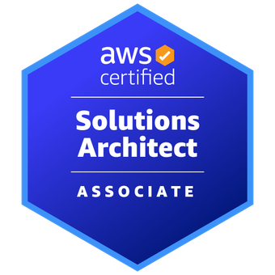

  <!--
  **vikas9dev/vikas9dev** is a ✨ _special_ ✨ repository because its `README.md` (this file) appears on your GitHub profile.
  -->

  

  

  ## 🛠️  Featured Work

  

  ---

  ### 🤖 AI Tools

  <table>
  <tr>
  <td valign="top" width="50%">

  ### ✨ [NoteSynth](https://github.com/vikas9dev/NoteSynth)

  AI-powered tool that transforms Udemy course captions into well-structured markdown notes using Google's Gemini API.

  **Tech Stack:** Next.js • TypeScript • Docker • Gemini API

  

  
  
  

  

  </td>
  <td valign="top" width="50%">

  ### 📊 [ccusage](https://github.com/vikas9dev/ccusage)

  Claude Code usage dashboard - beautifully visualize every token, cost, and project. Fully offline. No API key. No cloud. Just your data.

  **Tech Stack:** React • Python • Docker

  

  
  
                                                                                                                                                                                                                                                                                          
  

                                                                                                                                                                                                                                                                                          
  </td>                                                           
  </tr>
  <tr>
  <td valign="top" width="50%">

  ### 🎯 [claude-job-hunt](https://github.com/vikas9dev/claude-job-hunt)

  Claude Code skills for a software-engineering job search: find and score roles, research companies, tailor an ATS-safe resume, debrief interviews and compare offers — with a local tracker page. Your data stays private on your machine.

  **Tech Stack:** Claude Code Skills • Python • MCP (JobSpy) • HTML/JS

  

  
  

  

  </td>
  <td valign="top" width="50%">
  </td>
  </tr>
  </table>

  ---                                                                                                                                                                                                                                                                                     
   
  ### 📚 Interview Prep Notes

  Free, plain-English notes for backend interviews. Every note is ranked by how often the topic is asked (🔥🔥 / 🔥 / ⚡ / 💤).

  <table>
  <tr>
  <td valign="top" width="50%">

  ### 🧮 [DSA in Java](https://github.com/vikas9dev/dsa-algo)

  Data structures & algorithms for coding interviews: patterns, dry runs and LeetCode / GeeksforGeeks solutions in Java.

  **Content:** 39 notes • Arrays → DP, Graphs, Tries • Pattern guides

  

   

  

  </td>
  <td valign="top" width="50%">

  ### ☕ [Java & Spring Boot](https://github.com/vikas9dev/java)

  Java backend interview questions with full answers: Core Java, collections, multithreading, Java 8, Spring Boot, JPA, security, microservices.

  **Content:** 336 notes • Q&A banks • GoF design patterns • Java tutorial

  

   

  

  </td>
  </tr>
  <tr>
  <td valign="top" width="50%">

  ### 🏗️ [System Design](https://github.com/vikas9dev/system-design)

  HLD and LLD interview notes: databases, Redis, Kafka, REST, distributed systems, case studies, full designs and machine coding.

  **Content:** 59 notes • Alex Xu Vol 1 & 2 chapter notes • LLD problems

  

   

  

  </td>
  <td valign="top" width="50%">

  ### ☁️ [AWS](https://github.com/vikas9dev/aws)

  AWS for system-design interviews (`system_design` branch) and full AWS SAA-C03 exam notes (`main` branch).

  **Content:** SAA-C03 notes • AWS for HLD rounds • Limits checked against AWS docs

  

   

  

  </td>
  </tr>
  </table>

  ---

  ### ☁️  DevOps & Cloud                                                                                                                                                                                                                                                                   
                                                                  
  <table>
  <tr>
  <td valign="top" width="50%">

  ### 🧩⚡ [ComputeHub | Multi-Container Hub](https://github.com/vikas9dev/multi-container-compute-hub)                                                                                                                                                                                   
   
  A high-performance microservices architecture orchestrating React, Express, and Worker services. Orchestrated with **Kubernetes (GKE)**, automated via **Skaffold**, and deployed through **GitHub Actions**. Features automated SSL (Cert-Manager) and persistent data volumes.        
                                                                  
  **Tech Stack:** GKE (Kubernetes) • Docker • Skaffold • GitHub Actions • Ingress-Nginx • Postgres • Redis                                                                                                                                                                                
                                                                  
  
                                                                                                                                                                                                                                                                      
                                                                  
                                                                                                                                                                               
                                                                                                                                                                                                                                                                                          
  
                                                                                                                                                                                                                                                                                  
                                                                                                                                                                                                                                                                                          
  </td>                                                           
  <td valign="top" width="50%">

  ### 🐳☁️  [docker-react](https://github.com/vikas9dev/docker-react)                                                                                                                                                                                                                      
   
  Single-container React app with a production CI/CD pipeline and AWS Elastic Beanstalk deployment.                                                                                                                                                                                       
                                                                  
  **Tech Stack:** React • Docker • GitHub Actions • AWS Elastic Beanstalk                                                                                                                                                                                                                 
                                                                  
  
                                                                                                                                                                                                                                                                      
                                                                  
                                                                                                                         
                                                                                                                                                                                                                                                                                          
  
                                                                                                                                                                                                                                                                                  
                                                                                                                                                                                                                                                                                          
  </td>                                                           
  </tr>
  </table>
                                                                                                                                                                                                                                                                                          
  ---                                                             

  ## 🎓 Certifications

  
                                                                                                                                                                                                                                                                      
    <a href="https://www.credly.com/badges/398d8c82-ec2f-4e6c-803a-a0bd074fe970" target="_blank" rel="noopener noreferrer">
                                                                                                                                                                                        
    </a>                                                                                                                                                                                                                                                                                  
  
                                                                                                                                                                                                                                                                                    
                                                                                                                                                                                                                                                                                          
  
                                                                                                                                                                                                                                                                      
    <strong>                                                      
      <a href="https://www.credly.com/badges/398d8c82-ec2f-4e6c-803a-a0bd074fe970"
         target="_blank" rel="noopener noreferrer">                                                                                                                                                                                                                                       
        AWS Certified Solutions Architect – Associate (SAA-C03)
      </a>                                                                                                                                                                                                                                                                                
    </strong>                                                 
    Issued by Amazon Web Services (AWS)                                                                                                                                                                                                                                                   
  

                                                                                                                                                                                                                                                                                          
  ---                                                             

  ## 🔗 Connect

  
                                                                                                                                                                                                                                                                    
   
                                                                                                                                                                   
  💼 **Open to collaboration on interesting projects!**                                                                                                                                                                                                                                   
                                                                                                                                                                                                                                                                                          
  
                                                                                                                                                                                                                                                                                  
                                                                  
  ---

  **Resources**

  🔹[DSA in Java](https://github.com/vikas9dev/dsa-algo) 🔹[Java & Spring Boot](https://github.com/vikas9dev/java) 🔹[System Design](https://github.com/vikas9dev/system-design) 🔹[AWS](https://github.com/vikas9dev/aws)
